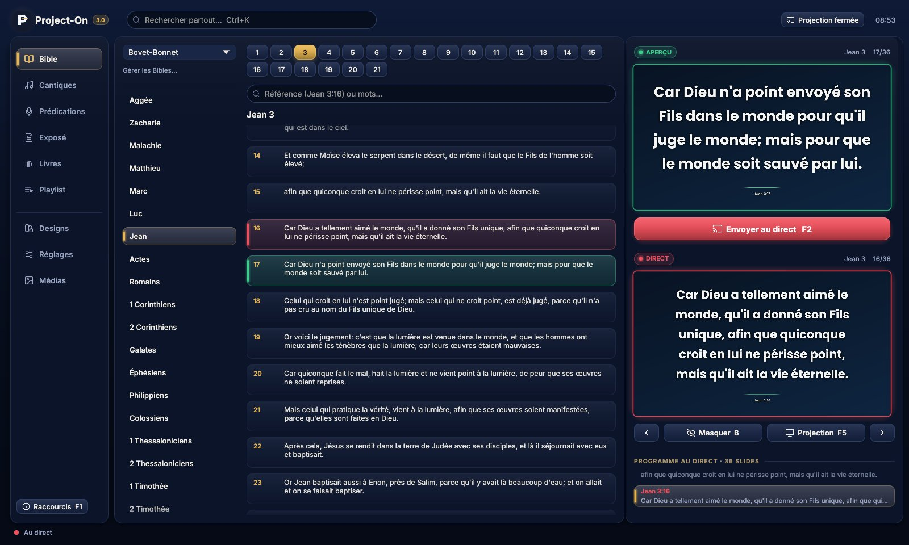
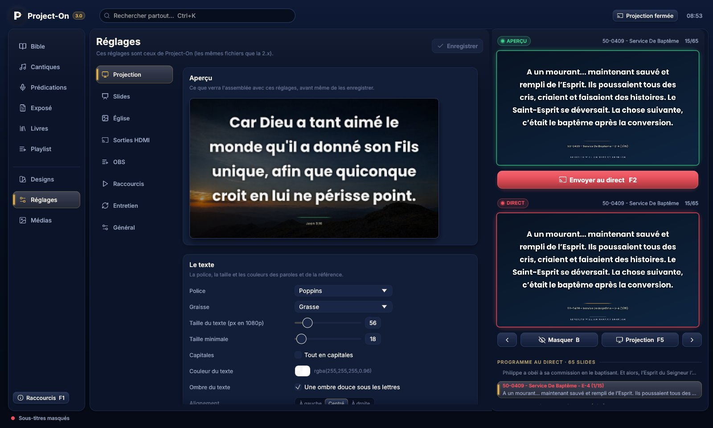

# Project-On

**Logiciel de projection pour églises — Bible, cantiques, prédications, Exposé des Sept Âges.**
Projection plein écran · écrans Web · NDI · HDMI pour mélangeur · 100 % hors ligne.

[**🌐 Site web**](https://elieny7.github.io/paratech-web/project-on.html) · [**⬇️ Télécharger**](https://elieny7.github.io/paratech-web/project-on.html) · [Captures d'écran](#aperçu)

---

Depuis la **3.0**, Project-On est écrit entièrement en **Rust** (interface egui sur la carte
graphique). Le code est dans [`project-on-rs/`](project-on-rs/README.md). La 2.8, écrite en Python
(PySide6), est retirée du dépôt : son code reste disponible à l'étiquette git **`v2.8-python`**
(`git checkout v2.8-python`), et son installateur sur la
[page des versions](https://github.com/elieNy7/paratech-web/releases/tag/project-on-v2.8.0).

## ✨ Fonctionnalités

- **Bible** — 7 Bibles libres fournies, d'autres à télécharger, import XML et JSON (lingala, swahili…), recherche « Jean 3:16 » ou par mots.
- **Cantiques** — bibliothèque par strophes, refrain répété tout seul, éditeur, import d'un recueil PDF.
- **Prédications, Exposé et livres** — alinéas fidèles au PDF, identification de Branham au choix.
- **Aperçu puis Direct** — un clic prépare, **F2** envoie ; tout le chapitre, le cantique ou la prédication devient le programme, découpé en parties équilibrées.
- **Playlist et déroulé du culte** — glisser-déposer, sections avec heures prévues, avance ou retard en direct ; PowerPoint, images et vidéos.
- **Designs** — une bibliothèque de designs, lower thirds et sous-titres ; le design choisi sert au Web, à NDI et au HDMI.
- **Sorties** — projection plein écran, écrans Web (salle, diffusion transparente, sous-titres, retour de scène), NDI transparent, HDMI sur fond de clé pour ATEM ou Roland, pilotage d'OBS.
- **L'église** — écran d'accueil, orateur du jour, réseaux sociaux avec QR code, images de citation (Ctrl+Maj+I), galerie de photos.
- **Fiabilité** — reprise après une coupure de courant, contrôle avant culte, sauvegardes et restauration, mise à jour intégrée.

## ⬇️ Installation (Windows)

1. Téléchargez **`ProjectOn_3.0.0_Setup.exe`** depuis la [page Project-On](https://elieny7.github.io/paratech-web/project-on.html).
2. Lancez l'installateur. Si Windows affiche **SmartScreen** : « Informations complémentaires » → « Exécuter quand même ».
3. Ouvrez **Project-On** : la 3.0 reprend la base, les playlists et les réglages de la 2.x.

> Windows 10 / 11 (64 bits) · environ 1 Go d'espace · un second écran ou projecteur recommandé.

## 🖼️ Aperçu

| Régie | Réglages |
|---|---|
|  |  |

## 🛠️ Développement

Voir [`project-on-rs/README.md`](project-on-rs/README.md) : construire, vérifier (`cargo test`),
installateur (`construire-beta.ps1 -Bascule`).

## 📜 Licence & crédits

- Code : voir [LICENSE.txt](LICENSE.txt) (MIT).
- Bibles fournies et catalogue : [scrollmapper/bible_databases](https://github.com/scrollmapper/bible_databases), domaine public (détail dans `licenses/BIBLES.txt`).
- Silhouettes aigle / lion / agneau dérivées de [game-icons.net](https://game-icons.net/) (Lorc, Delapouite) — **CC BY 3.0**.
- Logos des réseaux sociaux : [Simple Icons](https://simpleicons.org) — **CC0** (détail dans `licenses/SIMPLE-ICONS-CC0.txt`).
- Icônes d'interface issues de [Lucide](https://lucide.dev/) — licence **ISC** (`licenses/LUCIDE-ISC.txt`).

© 2026 Onzième Heure Tab · Publié par Elie Nyembo

