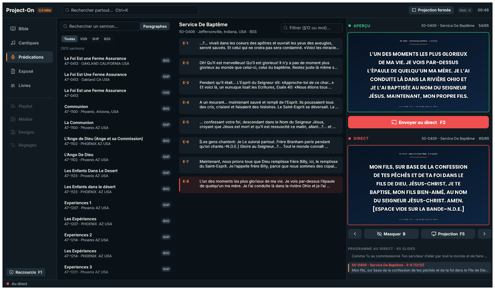

# Phase 3 : rapport de la régie et de la bibliothèque — première bêta

**Dates** : 10 et 11 novembre 2026. **Résultat** : la première bêta utilisable de Project-On 3.0. Elle
s'installe à côté de la 2.8, travaille sur une copie de ses données, et fait le travail du culte :
la Bible, les cantiques, les prédications, l'Exposé et les livres, l'Aperçu puis le Direct, la
projection sur un ou plusieurs écrans, la recherche globale et les raccourcis de la 2.8. Le
livrable fixé par l'audit (§ 8, phase 3) est tenu : un installateur
`Project-On_3.0.0-beta.1_Setup.exe` (Inno Setup, sans droits d'administrateur).

## Ce qui a été construit

| Partie | Contenu |
|---|---|
| `po-program` (nouvelle) | Le programme : ce qu'un clic prépare. Tout le sermon (alinéas d'un même paragraphe réunis), le chapitre de la Bible, le cantique (refrain répété selon les réglages) ou le chapitre d'un ouvrage, découpé en slides « réf (i/n) » ; la navigation suivant / précédent / début / fin. |
| `po-layout`, `po-render` | Le plan des transitions est séparé de leur dessin : la carte graphique et le processeur suivent le même plan. Le rendu donne les trois couches d'un slide (fond, contenu, identification) pour la carte graphique. |
| `project-on` (refaite) | La régie complète, décrite ci-dessous, avec le système de design de Pgraphics : thème, icônes Lucide, boutons, contrôle segmenté, lignes de liste. |
| `po-parite programme` | Les tests dorés du programme, contre le vrai code de la 2.8. |
| `construire-beta.ps1`, `installer/` | Le dossier de la bêta et son installateur. |

Environ 6 000 lignes ajoutées (du Rust surtout) ; 98 tests dans l'espace de travail, dont 8 essais de la
régie entière rendue hors écran. Aucune fenêtre ne s'ouvre pendant les tests.

## La régie

- **Le rail** : Bible, Cantiques, Prédications, Exposé, Livres (Ctrl+1 à Ctrl+5). Playlist,
  Médias, Designs et Réglages y figurent en gris, avec la phase où ils arrivent.
- **Prédications** : les 2 815 sermons, filtrés par titre et par traduction (VGR, SHP, BSS) ; les
  paragraphes du sermon choisi, avec un filtre « §12 » ou un mot ; Ctrl+G cherche dans les
  paragraphes de tous les sermons.
- **Bible** : la traduction (la première française par défaut), les livres, la grille des
  chapitres et les versets. Le champ de recherche accepte une référence (« Jean 3:16 », « Ps 23 »,
  Entrée l'ouvre) ou des mots, cherchés dans toute la traduction.
- **Cantiques** : par numéro ou titre, ou dans les paroles ; les strophes avec leur étiquette.
- **Exposé** (VGR et SHP) et **Livres** (les deux biographies et les brochures) : l'ouvrage, ses
  chapitres, et les paragraphes du chapitre page par page, avec une recherche dans l'ouvrage.
- **Un clic prépare, un double-clic projette.** Comme dans la 2.8, un clic prépare dans l'Aperçu
  tout le programme à partir de l'entrée cliquée. Un double-clic l'envoie directement au direct.
  La ligne préparée porte un liseré vert, celle du direct un liseré rouge.
- **Aperçu et Direct** : les deux moniteurs, « Envoyer au direct (F2) », suivant / précédent,
  Masquer (B, fondu du texte, le fond reste) et la projection (F5). Sous le Direct, la liste des
  slides du programme ; un clic y saute au slide.

## Le programme, identique à la 2.8

`outils/references_programme_28.py` fait préparer par **le vrai code de la 2.8** des programmes
entiers sur une copie de la base. Il appelle `build_slides`, `presentation_slide` et les entrées
préparées par `LibraryController`, sans fenêtre ni objet Qt. `po-parite programme` refait tout en
Rust et compare.

| Programmes | Nombre | Différences |
|---|---:|---:|
| Sermons (un sur 23) | 123 | 0 |
| Cantiques (un sur 7) | 274 | 0 |
| Chapitres de la Bible (11 traductions) | 517 | 0 |
| Chapitres d'ouvrages (Exposé VGR et SHP, biographies, brochures) | 22 | 0 |
| **Total, pour 4 réglages de découpage** : 310 032 slides, 15 518 comparaisons | **936** | **0** |

Les quatre réglages : les vôtres, ceux par défaut, sans découpage, et un découpage court sans
compteur ni refrain répété. Pour chaque programme, la comparaison porte sur :

- les entrées : références et textes ;
- les slides : découpage et « (i/n) » ;
- le premier slide de chaque entrée ;
- le slide tel que les écrans le montrent : le titre d'un cantique sur sa propre ligne, l'étiquette
  de strophe retirée ;
- le titre du programme et l'entrée cliquée.

L'outil a été vérifié à l'envers : un réglage et un texte modifiés volontairement donnent 1 086
différences.

## La projection native

- **Sur la carte graphique.** Un slide est mis en page puis dessiné une seule fois, par un fil à
  part, en trois couches. Pendant une transition, la carte graphique pose les couches de l'ancien
  et du nouveau slide à chaque image. Le Direct et chaque écran de projection montrent les mêmes
  textures : aucun rendu de plus par écran.
- **Le même plan que le processeur.** La transition est calculée une fois
  (`po_layout::transition::plan`), puis posée par la carte graphique ou dessinée par le processeur
  (captures, futures sorties NDI et HDMI). Un essai compare les deux images, pour les cinq
  transitions à cinq instants chacune :

  | Transition | Écart moyen le plus grand (niveaux sur 255) | Pixels à plus de 24 niveaux |
  |---|---:|---:|
  | Fondu | 0,04 | 0 % |
  | Glissement | 0,41 | 0,8 % (bords des lettres en mouvement) |
  | Zoom | 0,04 | 0 % |
  | Flou | 0,05 | 0 % |
  | Balayage | 0,10 | 0,1 % |

  La phase 2 relevait 80 à 100 ms par image de transition sur le processeur. Désormais, une image
  de l'interface pendant une transition prend 0,4 ms de processeur ; le reste est fait par la
  carte graphique.
- **L'écran** est choisi comme dans la 2.8 : celui des réglages (`display_screen`, même nom Windows
  que Qt), sinon le plus grand des écrans secondaires. La fenêtre est sans bord, au premier plan,
  posée au pixel près, sans curseur. Échap la ferme.
- **Plusieurs écrans** : un clic droit sur « Projection » liste les écrans branchés. Chacun peut
  projeter, avec les mêmes textures. Le rendu se fait à la taille du plus grand écran (borné à
  2560 de large). F5 ouvre l'écran par défaut ou ferme toutes les projections.
- **Avec un seul écran**, la projection s'ouvre dans une fenêtre. En plein écran, elle couvrirait
  la régie (la 2.8 le faisait).

## Les données de la bêta

- **Au premier lancement**, la bêta copie la base et `settings.json` de la 2.x dans
  `%APPDATA%\Project-On 3 (bêta)`. La base est copiée par l'API de sauvegarde de SQLite, comme une
  sauvegarde de la 2.8 ; la copie est vérifiée puis publiée par renommage. Un écran l'annonce
  pendant la copie, quelques secondes.
- **La 2.x n'est jamais modifiée.** Un essai vérifie que la base d'origine est identique, octet
  pour octet, après la copie. Une copie déjà présente n'est jamais écrasée. La bêta n'écrit rien
  en phase 3 (base ouverte en lecture seule).
- **Lecture de la base en arrière-plan** (proposée en phase 1) : au lancement, un fil lit la base
  une fois, et la première recherche n'attend plus le disque. Sur ce poste : 595 Mo en 0,9 s,
  base déjà en mémoire.
- **Sans 2.x** sur le poste, la bêta le dit et ne crée rien.

## Recherche globale et raccourcis

- **Ctrl+K** cherche comme la 2.8 :
  - la Bible : une référence d'abord, sinon les versets de la traduction choisie ;
  - les prédications : titres, puis paragraphes ;
  - l'Exposé.

  Les cantiques en restent exclus, comme dans la 2.8. Les résultats se choisissent à la souris ou
  avec les flèches puis Entrée, et préparent l'Aperçu.
- **Un défaut trouvé par les essais** : la traduction de la Bible n'était choisie qu'à la première
  ouverture de la page Bible, et la recherche globale ne trouvait alors aucun verset. Elle est
  maintenant choisie au démarrage.
- **Les raccourcis de la 2.8**, avec ceux que l'opérateur a changés dans ses réglages :
  - F2 (au direct), Page suivante / précédente, B (masquer), F5 (projection) ;
  - Ctrl+K, Ctrl+F (recherche de la page), Ctrl+G (paragraphes), F1 (aide) ;
  - et, fixes, les flèches, Début et Fin.

  Une touche sans modificateur n'agit pas pendant une saisie : taper « Bible » ne masque pas le
  texte (essai). Les raccourcis des fonctions à venir sont listés dans l'aide (F1) avec leur
  phase.
- **Clavier français** : un essai tape « grâce » comme le fait la touche morte d'un clavier
  AZERTY. Les champs de recherche ont un nom pour les lecteurs d'écran (AccessKit).

## Mesures

Sur ce poste (i5-8350U, UHD 620), sur la copie de la vraie base, avec vos réglages de projection
(Poppins, ombre portée, fondu) :

| Mesure | Résultat |
|---|---:|
| Première image de la régie (base ouverte, Bible chargée) | 1,6 s |
| Clic sur un paragraphe → Aperçu dessiné (premier / suivants) | 422 ms / 90 ms |
| F2 → slide au direct | 76 ms |
| Slide suivant (médiane / p95) | 81 / 119 ms |
| Image de l'interface pendant une transition (processeur) | 0,4 ms |
| Recherche globale : « Jean 3:16 » / « ferme assurance » / « grâce » (index des versets à construire) | 7 / 23 / 268 ms |
| Latence des écrans Web (médiane) | 7,5 ms |

Les 80 ms d'un slide sont celles de la mise en page de la 2.8 et du dessin des lettres et de
l'ombre par le processeur, en 1080p. L'interface ne les attend jamais (fil à part). Le premier
clic paie aussi le chargement des polices et de DirectWrite. Détail : [`mesures.json`](mesures.json).

## Vérifications refaites

- Phase 1 (fondations) : 1 131 437 cas comparés à la 2.8, 0 différence.
- Phase 2 (mise en page de la projection) : 2 208 slides, 100 % identiques (écart maximal 1 px).
- `cargo fmt`, `clippy -D warnings`, 98 tests : tout passe.

## Différences voulues avec la 2.8

- Avec un seul écran, la projection s'ouvre dans une fenêtre, pas en plein écran.
- La Bible ouvre la première traduction française, et non la première de la liste.
- L'Aperçu et le Direct montrent le slide mis en page à la taille de l'écran de projection (déjà
  en phase 2).

## Ce que la bêta ne fait pas encore

- **Playlist et déroulé du culte** : phase 4.
- **Écrans Web** : ils montrent le direct, mais leur gestion (plusieurs écrans, reconnexion, état
  dans la barre) arrive en phase 5.
- **Designs** : bandeau bas, sous-titres, lower thirds, NDI et sortie HDMI arrivent en phase 6.
- **Phase 7** : médias et vidéos, PowerPoint, les réglages (la bêta utilise la copie de ceux de la
  2.8, sans pouvoir les changer), les écrans de l'Église, l'historique, les imports, la mise à
  jour.
- **La copie des données est faite une fois.** Pour repartir des données récentes de la 2.8, il
  faut supprimer le dossier `Project-On 3 (bêta)` ; un bouton « Recopier » viendra avec les
  réglages.
- **L'installateur n'est pas signé** : Windows SmartScreen peut demander une confirmation.
- **Pas encore essayé sur un vrai vidéoprojecteur.** Les essais ne montrent aucune fenêtre ; la
  pose sur l'écran utilise le code de Pgraphics, éprouvé sur ce matériel. C'est le premier essai
  à faire avec la bêta, avant le prochain culte.

## Essayer la bêta

1. Lancer `installer\Output\Project-On_3.0.0-beta.1_Setup.exe` : la bêta s'installe dans vos
   programmes, à côté de la 2.8, et apparaît dans le menu Démarrer sous « Project-On 3 (bêta) ».
2. Au premier lancement, elle copie vos données de la 2.8 ; la 2.8 reste utilisable telle quelle.
3. Brancher le vidéoprojecteur, choisir un paragraphe, F2, puis F5. Le clic droit sur
   « Projection » permet de choisir l'écran.

## Incidents et solutions

- **Le banc de mesure accumulait les textures.** Sans dessin entre deux étapes, kittest envoyait
  toutes les couches à la carte graphique d'un coup (délai dépassé). La vraie fenêtre dessine
  chaque image ; le banc fait de même maintenant.
- **Deux plantages du compilateur** (erreurs internes sur un cache de compilation) : disparus à la
  compilation suivante, sans changement de code.
- **Les essais retrouvent les widgets par leur nom d'accessibilité** : les champs de recherche
  n'en avaient pas, ils en ont un.

## Suite proposée : la phase 4 (playlist et déroulé)

- La parité avec la 2.8 : sections repliables, glisser-déposer, sélection multiple, copier et
  déplacer, Ctrl+Z, paragraphe entier.
- La bêta commencera à écrire dans sa copie de la base (playlists), avec les migrations
  additives seulement.
- Livrable : tests du modèle et essai guidé avec vous.
