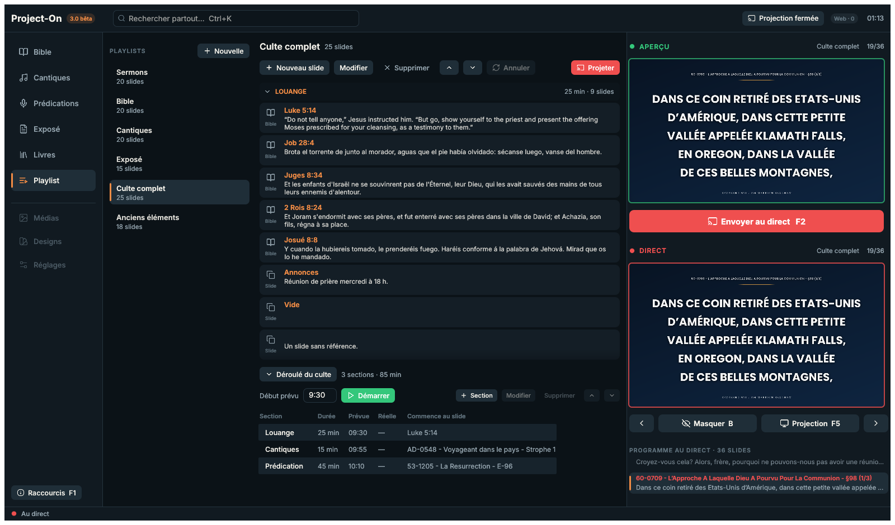

# Phase 4 : rapport de la playlist et du déroulé

**Date** : 11 novembre 2026. **Résultat** : la bêta a la playlist et le déroulé du culte de la 2.8,
avec tous leurs gestes :
- sections repliables ;
- glisser-déposer et sélection multiple ;
- dupliquer, copier, déplacer ;
- Ctrl+Z sur 30 étapes ;
- paragraphe entier.

Le livrable fixé par l'audit (§ 8, phase 4) est tenu : les tests du modèle passent, dont ceux de la
2.8 repris valeur pour valeur, et un [essai guidé](ESSAI_GUIDE.md) vous attend sur la bêta 2
(`Project-On_3.0.0-beta.2_Setup.exe`).



## Ce qui a été construit

| Partie | Contenu |
|---|---|
| `project-on/src/playlist.rs` | Le modèle :<br>– le genre de chaque élément (`item_kind` de la 2.8) ;<br>– le programme projeté depuis une playlist (`on_playlist_play`) ;<br>– la sélection déplacée d'un cran et le glisser-déposer ;<br>– l'annulation sur 30 étapes ;<br>– chaque modification de playlist, annulable comme dans `LibraryController`. |
| `project-on/src/service.rs` | Le déroulé (`service_plan.py` de la 2.8) : heure de début, section en cours, temps restant, avance ou retard en direct, fin estimée. |
| `project-on/src/library/playlist.rs` | La page Playlist, décrite ci-dessous. |
| Bibliothèques | Le clic droit sur un verset, une strophe ou un paragraphe : projeter, préparer, « Ajouter à la playlist… », « une plage… », « tout le chapitre », « tout le cantique ». |
| `po-program` | Une playlist mêle Bible, cantiques et sermons : chaque slide garde son genre, donc son identification. |
| `po-parite playlist`, `outils/references_playlist_28.py` | Les tests dorés des playlists, contre le vrai code de la 2.8. |

Environ 2 500 lignes ajoutées ; 110 tests dans l'espace de travail (12 de plus qu'en phase 3).

## La page Playlist

- **Les playlists** à gauche (nombre de slides) ; clic droit : renommer, supprimer (avec
  confirmation : la suppression d'une playlist ne s'annule pas, comme dans la 2.8).
- **Les slides** : le genre (Bible, Cantique, Sermon, Exposé, Image, Vidéo, PowerPoint, Slide) avec
  son icône, la référence et deux lignes de texte. Un clic prépare la playlist dans l'Aperçu à
  partir de ce slide, un double-clic l'envoie au direct, et « Projeter » part du slide choisi. Le
  slide préparé porte un liseré vert, celui du direct un liseré rouge.
- **Sélection multiple** : Ctrl+clic, Maj+clic, Ctrl+A.
- **Déplacer** : par glisser-déposer (un trait orange montre où la sélection se posera), ou d'un
  cran avec ▲ ▼ et Ctrl+↑ / Ctrl+↓. Un slide ne passe jamais par-dessus un autre slide choisi.
- **Clic droit** : projeter à partir d'ici, préparer, modifier, dupliquer (Ctrl+D), copier ou
  déplacer vers une autre playlist, commencer une section ici, supprimer (Suppr).
- **Annuler** (Ctrl+Z ou bouton) : toute modification de playlist, sur 30 étapes, y compris un ajout
  depuis la Bible, les cantiques ou les sermons. Les mêmes identifiants reviennent.
- **Nouveau slide / Modifier** : un slide saisi (référence et texte).

## Ajouter à la playlist

Clic droit dans une bibliothèque, puis une fenêtre : la playlist (celle ouverte est proposée
d'office) ou une nouvelle, et pour « une plage… » le premier et le dernier élément. Comme dans la
2.8 :

- un paragraphe de sermon s'ajoute **entier**, avec tous ses alinéas, un par ligne ;
- un paragraphe de l'Exposé porte « titre du chapitre · Page 3 §2 » ;
- chaque élément garde son genre (`bible`, `hymn`, `sermon`, `expose`).

## Le déroulé du culte

- Sous les slides, **Déroulé du culte** :
  - l'heure de début prévue (« 9:30 », « 9h30 ») ;
  - Démarrer / Arrêter et Section suivante ;
  - le tableau des sections : durée, heure prévue, heure réelle, slide de départ ;
  - Ajouter, Modifier, Supprimer, ▲ ▼ ; des noms proposés (Louange, Annonces, Prédication…).
- **Une section liée à un slide** devient un en-tête repliable au-dessus de lui, avec sa durée et
  son nombre de slides. Clic droit sur un slide : « Commencer une section ici ».
- **Pendant le culte** : la section en cours, le temps restant ou le dépassement, l'avance ou le
  retard en direct, la fin estimée.
- **Une section démarre toute seule** quand son slide passe au direct : par double-clic, par
  « Projeter », par F2 après un clic, comme dans la 2.8. Elle démarre aussi quand on y arrive avec
  « slide suivant », ce que la 2.8 ne faisait pas ; c'est pourtant ce qu'annonçaient ses notes de
  version.

## Identique à la 2.8

Les tests dorés : sur une copie de la base, `outils/references_playlist_28.py` fait créer par la 2.8
six playlists de vrai contenu :

- des paragraphes de sermons, des versets de plusieurs traductions, des strophes ;
- des paragraphes de l'Exposé ;
- des slides saisis (dont un vide et un sans référence) ;
- une image et une vidéo ;
- d'anciens éléments « custom » dont le genre se devine d'après la référence.

Puis le vrai `on_playlist_play` de la 2.8 prépare chaque playlist depuis cinq slides de départ (le
début, le premier, le milieu, le dernier, un slide disparu). `po-parite playlist` refait tout avec
la 3.0.

| Comparaison | Cas | Différences |
|---|---:|---:|
| Programme d'une playlist (titre, entrées, slide de départ) | 30 (1 115 slides) | 0 |
| Genre de chaque élément | 118 | 0 |

L'outil a été vérifié à l'envers : trois valeurs modifiées volontairement donnent trois
différences.

Les essais de la 2.8 ont été repris valeur pour valeur :

- le genre deviné des anciens éléments ;
- la sélection déplacée ;
- l'annulation dans l'ordre, avec les mêmes identifiants rendus ;
- les étapes d'une playlist supprimée oubliées ;
- l'heure de début ;
- l'avance, le retard et le dépassement du déroulé.

Les opérations sur la base (ajouter, réordonner, dupliquer, copier, déplacer, instantanés, sections)
étaient déjà comparées à la 2.8 en phase 1.

Les vérifications des phases précédentes ont été refaites et passent toujours :
- programme : 936 programmes, 0 différence ;
- mise en page : 2 208 slides identiques.

## Les essais de l'interface (sans fenêtre)

- **Ajouter puis annuler** : clic droit sur un paragraphe de sermon → nouvelle playlist « Culte ».
  Le paragraphe entier s'ajoute, puis tout Jean 3 (« Ajouter tout le chapitre », 36 versets) ;
  « Annuler » retire le chapitre.
- **Organiser** : clic, Ctrl+clic, Ctrl+↓ (ordre BADCE), Suppr, Ctrl+Z, puis le dernier slide glissé
  tout en haut à la souris (EBADC).
- **Au direct** : un clic prépare l'Aperçu sur le verset, F2 l'envoie au direct, aucune section ne
  commence. Page suivante amène le paragraphe de sermon : la section « Prédication » démarre, et le
  slide porte l'identification de Branham, même joué depuis une playlist.

## Écritures dans la base

En phase 4, la bêta écrit pour la première fois, et seulement dans **sa copie**
(`%APPDATA%\Project-On 3 (bêta)`). Elle n'ouvre jamais la base de la 2.x en écriture. Une copie
venue d'une 2.x plus ancienne reçoit les migrations, toutes additives ; une copie à jour n'est pas
réécrite.

## Différences voulues avec la 2.8

- **Médias dans une playlist** : les images, vidéos et PowerPoint y figurent avec leur genre et la
  mention « phase 7 », mais ne sont pas encore projetés ; la projection les saute.
- **Suppr sans confirmation** : la 2.8 demandait de confirmer la suppression de slides, la bêta les
  supprime et annonce « Ctrl+Z annule ». La suppression d'une playlist, qui ne s'annule pas, reste
  confirmée.
- **Les sections démarrent aussi avec « slide suivant »** (voir plus haut).
- **Les éléments sans playlist** (une ancienne version en laissait ; votre base en a 9) restent
  invisibles, comme dans la 2.8.

## Ce que la phase 4 ne fait pas

- **L'import et l'export d'une playlist** (fichier) et le **diaporama** d'un dossier de médias :
  avec les médias, phase 7.
- **L'historique du culte** (bouton du déroulé de la 2.8) : phase 7.
- **Raccourci « section suivante »** (Ctrl+Alt+N) : le bouton existe, le raccourci viendra avec les
  réglages des raccourcis (phase 7).
- **Pas de retour vers la 2.8** : les playlists de la bêta restent dans sa copie, les deux versions
  ne se synchronisent pas.

## Correctif de la bêta 3 (11 novembre) : rien ne s'affichait

**Le symptôme** : sur votre portable, l'installateur de la bêta 1 s'exécutait, puis la régie ne
montrait rien.

**La cause**, lue dans le journal des erreurs de Windows : la bêta plantait à la première image,
dans `igvk64.dll`, le pilote **Vulkan** de l'Intel UHD 620 (version 31.0.101.2127), avant même de
copier vos données. La bibliothèque graphique (wgpu) avait choisi Vulkan. Pgraphics avait mesuré
le même plantage sur ce portable le 20 octobre et s'en protégeait ; la régie de Project-On ne le
faisait pas. Les essais sans fenêtre ne pouvaient pas le voir : ils n'ouvrent pas de vraie
fenêtre.

**Le correctif** :
- **La carte graphique** : comme Pgraphics, DirectX 12 d'abord, OpenGL en repli, jamais Vulkan par
  défaut (`WGPU_BACKEND` impose un autre choix). Un essai vérifie, sans fenêtre, que ce poste reçoit
  bien une carte DirectX 12.
- **Plus de démarrage muet** : la carte choisie et toute panique sont écrites dans le journal
  (`%APPDATA%\Project-On 3 (bêta)\data\logs`). Si la régie ne peut pas s'ouvrir, un message le dit.
- **La base fournie** : l'installateur contient maintenant la base de l'installateur de la 2.8
  (`data\project_on.db`). Au premier lancement, quand vos données de la 2.8 sont aussi sur le
  poste, la bêta demande avec laquelle partir :
  - « Mes données de Project-On 2.8 » : playlists, cantiques ajoutés, Bibles importées, réglages ;
  - « La base fournie avec Project-On » : sans vos playlists, avec vos réglages de projection.

  Sans 2.8 sur le poste, la base fournie est prise d'office. Un essai de l'interface vérifie le
  choix, et que la 2.x reste intacte.

## Refaire les vérifications

```powershell
cd project-on-rs
cargo fmt --all -- --check
cargo clippy --workspace --all-targets -- -D warnings
cargo test --workspace
# depuis la racine du dépôt, sur une COPIE de la base :
py -3.14 project-on-rs\outils\references_playlist_28.py <copie\project_on.db> project-on-rs\target\phase4\ref28
cd project-on-rs
cargo run --release -p po-parite -- playlist target\phase4\ref28
cargo run --release -p po-mesures -- playlist target\phase4\ref28\playlist-28.db target\phase4\capture
```

## Suite proposée : la phase 5 (projection Web)

- Plusieurs écrans Web, la reconnexion automatique, la compatibilité de l'adresse `/obs` de la 2.8.
- L'état des écrans dans la barre de la régie.
- Livrable : des tests d'intégration avec plusieurs clients, une coupure puis une reprise.
