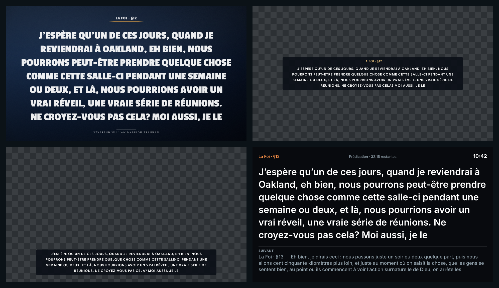
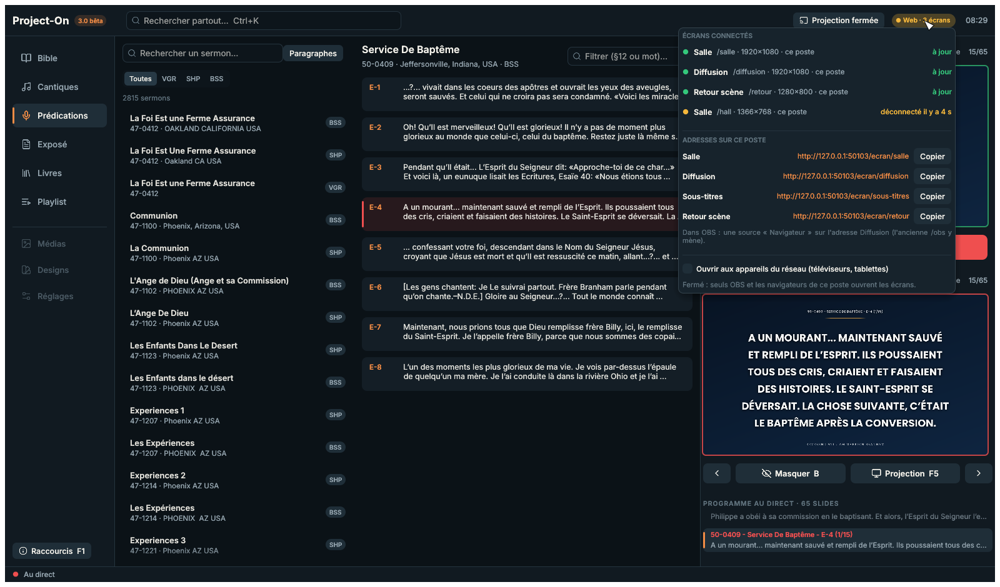

# Phase 5 : rapport de la projection Web

**Date** : 11 novembre 2026. **Résultat** : la projection Web de la 3.0 fait plus que la page `/obs`
de la 2.8. Elle propose quatre écrans au lieu d'un :
- la salle ;
- la diffusion pour OBS ;
- les sous-titres ;
- le retour de scène.

Chaque écran reçoit la mise en page et les transitions du vidéoprojecteur. La régie voit l'état de
chaque écran, et l'ouverture au réseau local est protégée par un QR code.

Le livrable fixé par l'audit (§ 8, phase 5) est tenu : des tests d'intégration avec plusieurs
clients, une coupure puis une reprise, l'adresse `/obs` de la 2.8 et l'état des écrans dans la
barre de la régie.



*En haut : la salle, puis la diffusion. En bas : les sous-titres, puis le retour de scène. Le damier
marque la transparence : là, OBS montre la vidéo. Le bandeau suit vos réglages « OBS » de la 2.8 :
centré, capitales, filet doré.*

## Les quatre écrans

Chaque écran a son adresse, `http://127.0.0.1:8090/ecran/<nom>`. L'accueil (`/`) les liste avec
le nombre d'appareils connectés à chacun.

| Écran | Adresse | Ce qu'il montre |
|---|---|---|
| **Salle** | `/ecran/salle` | Le slide plein écran, comme le vidéoprojecteur : fond, référence, identification de Branham. Pour les téléviseurs ou une salle annexe. |
| **Diffusion** | `/ecran/diffusion` | Le bandeau sur fond **transparent**, à poser sur la vidéo dans OBS, vMix ou Pgraphics. Le style vient de vos réglages « OBS » de la 2.x : position, police, capitales, filet, opacité, ombre, animation. |
| **Sous-titres** | `/ecran/sous-titres` | Le même bandeau, en bas, sans référence, sur deux lignes au plus. |
| **Retour scène** | `/ecran/retour` | Pour les chanteurs et le prédicateur. Il montre : <br>– le slide au direct, en grand ;<br>– le **suivant** ;<br>– l'**heure** ;<br>– la section du déroulé et son temps restant ;<br>– « TEXTE MASQUÉ » quand la salle ne voit plus le texte. |

N'importe quel autre nom ouvre un écran de salle de plus, par exemple `/ecran/hall` ou
`/ecran/accueil`. Les noms `obs`, `bandeau` et `stage` sont aussi reconnus.

## Mieux que la 2.8

| | 2.8 (`/obs`) | 3.0 |
|---|---|---|
| Écrans | Une page, le bandeau | Quatre genres, autant d'écrans que voulu |
| Mise en page | Faite par chaque navigateur (HTML/CSS) : coupures et tailles différentes d'un appareil à l'autre | Calculée par Project-On pour la taille de **chaque** écran, avec le moteur du vidéoprojecteur ; le navigateur ne fait que dessiner |
| Polices | Une liste de polices CSS : si la première manque sur l'appareil, le navigateur en prend une autre | Les fichiers de Project-On, chargés **avant** le premier dessin : jamais de police de secours |
| Transitions | Celles de la page | Les cinq du vidéoprojecteur (fondu, glissement, zoom, flou, balayage), **à l'identique** : un essai fait tourner le code du navigateur et le compare à celui du vidéoprojecteur sur 216 cas |
| Texte masqué (B) | — | Les écrans le masquent en fondu ; le fond reste |
| Retour de scène | — | Slide, suivant, heure, déroulé |
| État dans la régie | — | Chaque écran : connecté, en retard, déconnecté depuis… |
| Coupure réseau | — | L'écran garde sa dernière image et se reconnecte seul (0,5 à 5 s) ; il retrouve aussitôt le direct |
| Mise à jour de Project-On | Recharger à la main | La page se recharge d'elle-même si le protocole a changé |
| Réseau local | Un hôte réglé sur le réseau ouvrait le serveur à tous, sans authentification | Fermé par défaut ; ouvert sur demande, avec un **jeton** (QR code) |
| Pilotage | — | Toujours aucun : un écran reçoit, il ne commande rien |
| Veille | — | Le téléviseur ou la tablette reste allumé quand le navigateur le permet (adresse locale) ; double-clic : plein écran |

**Ce qui marche comme avant** : la source navigateur d'OBS réglée sur `/obs` (ou `/obs.html`,
`/presentation/obs`) mène à la diffusion, avec ses paramètres. `/slide.json` donne toujours le
slide au direct (`text`, `reference`, `source`, `hidden`), pour une intégration écrite pour la 2.8.

## Dans la régie



- **Le bouton « Web »** de la barre a trois couleurs. Gris : aucun écran ouvert. Vert, avec le
  nombre d'écrans : tout va bien. **Orange** : un écran est en retard (le dernier slide n'est pas
  affiché après 3 s, ou il ne répond plus) ou vient de se déconnecter. Il reste orange une minute.
- **Un clic** ouvre la fenêtre des écrans :
  - chaque écran connecté : genre, nom, taille, appareil (« ce poste » ou son adresse), état ;
  - l'adresse de chaque écran sur ce poste, avec **Copier** (pour OBS) ;
  - **Ouvrir aux appareils du réseau** : le QR code et l'adresse à taper, puis **Nouveau code**,
    qui rend les anciens codes inutilisables.
- Le choix « réseau local » et le jeton sont gardés dans `web.json`, dans les données de la bêta.

## Fiabilité et sécurité

- **Ce poste seulement par défaut** (127.0.0.1). Ouvert au réseau, le serveur demande le jeton à
  tout appareil autre que ce poste : dans l'adresse (`?t=…`, celle du QR code) puis dans un cookie
  que la page dépose. Sans jeton : « Adresse incomplète », et rien d'autre. OBS sur le poste de la
  régie n'a pas besoin de jeton.
- **Un port pris** (8090) : le serveur prend l'un des neuf suivants et la régie affiche le bon.
- **Changer l'accès** redémarre le serveur. Les écrans sont prévenus (code 1012), se reconnectent
  et retrouvent le direct.
- **Rien d'inutile sur le réseau.** Un changement qui ne concerne pas un écran ne lui est pas
  envoyé : l'heure ne part qu'au retour de scène. La même mise à jour deux fois ne part qu'une
  fois. Le slide déjà au direct, remis au direct, ne rejoue pas de transition.
- **La mise en page d'un écran** se calcule hors du fil réseau : un grand écran ne retarde pas les
  autres.

## Les essais

`po-web` compte 13 essais, avec de vrais clients WebSocket et HTTP :

| Essai | Vérifie |
|---|---|
| Plusieurs écrans, coupure, reprise | Deux tailles, chacune sa mise en page. Le direct arrive en moins de 500 ms. Les accusés de réception remontent. Un écran coupé passe « déconnecté » puis revient avec le direct. Une « commande » envoyée par un écran ne change rien. |
| Chaque genre son image | La salle a un fond ; la diffusion est transparente avec la référence en tête ; les sous-titres sont sans référence ; le retour de scène a l'heure, le suivant, le déroulé et aucune transition. |
| Texte masqué, heure | L'heure ne part qu'au retour de scène. Une mise à jour en double ne part pas. Le texte masqué est masqué en salle, mais montré (avec un bandeau) au retour de scène. |
| Serveur redémarré | Les écrans sont prévenus. Le même port revient. L'écran reçoit le slide mis au direct pendant la coupure. |
| Jeton | Sans jeton ou avec un faux : page, polices et WebSocket refusés. L'adresse du QR code passe et dépose le cookie. Ce poste peut être dispensé du jeton. |
| Adresses de la 2.8 | `/obs`, `/obs.html`, `/presentation/obs(.html)` mènent à la diffusion, paramètres compris. `/slide.json` répond. La page de diffusion est transparente. L'accueil liste les écrans et les connectés. |
| Port pris | Le serveur prend le suivant. |
| Transitions | Le code JavaScript du navigateur, exécuté par Node, donne les mêmes couches que celui du vidéoprojecteur : 6 transitions × 4 sens × 9 instants, au centième de pixel près. |

S'y ajoutent les essais du registre des écrans, du jeton et du QR code, et des mises en page du
bandeau (trois tailles d'écran) et du retour de scène. Deux essais de la régie, sans fenêtre,
complètent l'ensemble :
- **Jean 3:16 au direct** : les écrans reçoivent le verset et le suivant (3:17) ; Page suivante
  envoie 3:17 et annonce 3:18 ; le masquage leur parvient sans nouveau slide ; `/slide.json`
  répond ;
- **Le bouton « Web »** : les quatre adresses, le choix du réseau local ; la page de diffusion et
  l'ancienne adresse `/obs` répondent.

Dans un vrai navigateur, sur une copie de la base (`po-mesures servir`) : l'accueil, `/obs` qui
mène à la diffusion transparente avec vos réglages, le retour de scène et la salle s'affichent
comme sur la planche ci-dessus.

## Ce que la phase 5 ne fait pas

- **Les images et vidéos d'une playlist** sur les écrans Web : avec les médias, en phase 7. Les
  fonds images des slides sont déjà servis.
- **Régler les écrans** (choisir un autre style de bandeau pour un écran, créer ses propres
  genres) : avec les designs, en phase 6, et les réglages, en phase 7. Le port (8090 pour la bêta)
  passera à celui de la 2.x (8080) à la bascule, en phase 8.
- **Le pare-feu de Windows** : la première ouverture au réseau peut afficher sa demande
  d'autorisation ; acceptez pour les réseaux privés. L'installateur de la bascule ajoutera la
  règle lui-même.

## Refaire les vérifications

```powershell
cd project-on-rs
cargo fmt --all -- --check
cargo clippy --workspace --all-targets -- -D warnings
cargo test --workspace
# sur une COPIE de la base :
cargo run --release -p po-mesures -- web <copie\project_on.db> target\phase5\capture
cargo run --release -p po-mesures -- servir <copie\project_on.db> 8097   # puis http://127.0.0.1:8097/
```

## Suite : la phase 6 (designs)

- La bibliothèque de designs.
- Les lower thirds (au moins 12 styles, plus le bandeau de la 2.x).
- Les sous-titres, avec l'import SRT.
- Les autres dispositions (panneau latéral, carte).
- Les aperçus, et les sorties HDMI et NDI sur le même moteur de rendu.
