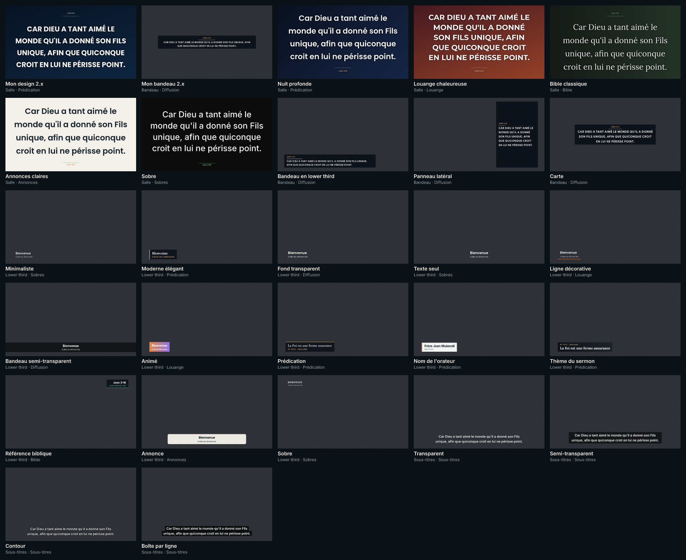
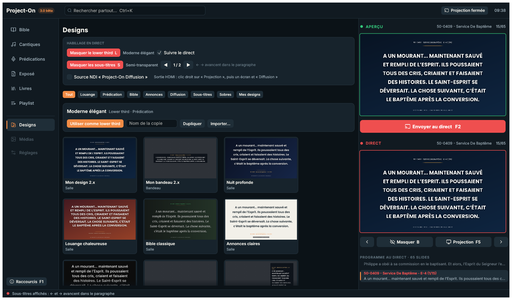

# Phase 6 : rapport des designs, lower thirds et sous-titres

**Date** : 11 novembre 2026. **Résultat** : la régie a sa page **Designs**, qui réunit :
- la bibliothèque de 27 designs intégrés, classés par catégorie et montrés avec le contenu en
  cours ;
- « Mes designs », qu'on duplique, personnalise, exporte et importe ;
- l'**habillage en direct** : lower third (touche L), sous-titres (touche S) ;
- les sorties de diffusion : source **NDI**, sorties **HDMI** sur une couleur de clé, mire (F8).

Le livrable fixé par l'audit (§ 8, phase 6) est tenu : une capture de chaque style intégré, et des
tests des animations et des sous-titres (lignes équilibrées, découpage, SRT).



*Chaque aperçu est un vrai rendu, avec le moteur des écrans. Le damier marque la transparence :
là, la vidéo passe.*

## La bibliothèque

| Genre | Designs intégrés |
|---|---|
| **Salle** (le slide plein écran) | **Mon design 2.x** (vos réglages « Projection »), Nuit profonde, Louange chaleureuse, Bible classique, Annonces claires, Sobre |
| **Bandeau** (le texte du slide sur la vidéo) | **Mon bandeau 2.x** (vos réglages « OBS »), Bandeau en lower third, Panneau latéral, Carte |
| **Lower third** (13) | Minimaliste, Moderne élégant, Fond transparent, Texte seul, Ligne décorative, Bandeau semi-transparent, Animé, Prédication, Nom de l'orateur, Thème du sermon, Référence biblique, Annonce, Sobre |
| **Sous-titres** (4) | Transparent, Semi-transparent, Contour, Boîte par ligne |

Les catégories : Louange, Prédication, Bible, Annonces, Diffusion, Sous-titres, Sobres, et « Mes
designs ».

- **Les aperçus sont réels.** Ils sont rendus par le moteur des écrans avec le contenu en cours :
  le slide de l'Aperçu, sinon celui du direct, sinon Jean 3:16. Le rendu se fait dans un fil à
  part, et un aperçu est refait quand son design ou le contenu change.
- **Un clic sur un design de salle** le pose dans l'**Aperçu**, sans toucher au direct.
  « Appliquer au direct » l'y envoie. Les autres genres ont leur bouton : « Utiliser pour la
  diffusion », « comme lower third », « pour les sous-titres ». Le direct ne change jamais par un
  simple clic.
- **Mes designs**, dans `data\designs` (un fichier JSON par design, écrit d'un coup : jamais à
  moitié). On y trouve :
  - « Dupliquer » ;
  - « Personnaliser » (voir plus bas) ;
  - « Supprimer » ;
  - « Exporter », dans « Documents\Project-On designs » ;
  - « Importer… », qui reprend les designs de ce dossier sans les doublons.

  Un fichier abîmé est ignoré, sans bloquer les autres.
- **Personnaliser**, selon le genre :
  - police, taille, couleurs ;
  - fond, dégradé, transition ;
  - boîte (aucune, unie, dégradé) ;
  - position (9 ancrages), alignement ;
  - entrée (fondu, glissement, révélation, mot à mot) ;
  - durée d'affichage ;
  - apparence et nombre de lignes des sous-titres.

  L'aperçu suit chaque changement.

## L'habillage en direct



- **Lower third (L)** : il entre et sort avec l'animation de son style : fondu, glissement,
  révélation ou **mot à mot**, avec sa courbe. Avec une durée d'affichage, il sort de lui-même. Le
  texte est saisi, ou **suit le direct** :
  - un verset donne sa référence ;
  - une prédication donne son titre et sa date ;
  - un cantique donne son titre et son numéro.
- **Sous-titres (S)** : un long paragraphe est découpé en sous-titres de 1 à 3 lignes
  **équilibrées**, de longueurs voisines (jamais un mot seul à la fin). Quand ils sont affichés,
  **← et →** avancent d'abord dans le paragraphe, puis passent au slide suivant ; en reculant, on
  arrive sur le dernier sous-titre du slide précédent. La salle garde le slide entier. La barre
  d'état indique « Sous-titre 2 / 5 ».
- **Où ils apparaissent** :
  - le lower third : sur l'écran Web « diffusion », la source NDI et les sorties HDMI
    « Diffusion » ;
  - les sous-titres : sur l'écran Web « sous-titres » et les sorties HDMI « Sous-titres ».

  Le vidéoprojecteur de la salle n'est pas habillé.

## Les sorties de diffusion

- **NDI** : la source « Project-On Diffusion » envoie le bandeau et le lower third en 1920 × 1080,
  **avec transparence** (BGRA). La 2.8 envoyait seulement le bandeau. La bibliothèque NDI est
  chargée à la demande : celle du dossier `ndi\` de l'application, sinon le runtime NDI 6
  installé (présent sur ce poste). Sans elle, la page le dit, et rien d'autre ne change. La page
  affiche le nombre de récepteurs connectés (vMix, OBS…). Le code vient de Pgraphics (MIT).
- **HDMI** : clic droit sur « Projection », puis, sous un écran, « Diffusion », « Sous-titres » ou
  « Retour scène ». L'écran devient une sortie plein écran pour un mélangeur (ATEM, Roland…). Le
  bandeau ou les sous-titres y sont posés sur la **couleur de clé** de vos réglages HDMI de la 2.x
  (vert, magenta ou bleu).
- **Mire (F8)** : sur les sorties HDMI, pour régler le mélangeur ou le vidéoprojecteur :
  - des barres de couleur ;
  - un dégradé de gris ;
  - le cadre de la zone de sécurité de 5 % ;
  - la définition de l'écran.
- **Un seul moteur.** Les écrans Web, la source NDI et les sorties HDMI montrent la même image
  pour un même genre d'écran. Pendant l'entrée ou la sortie d'un lower third, l'image se refait 30
  fois par seconde ; le reste du temps, seulement quand elle change.

## Le bandeau : les dispositions de la 2.x

Les dispositions « OBS » de la 2.x existent maintenant, réglées depuis `obs.output.layout_mode` :
- **sous-titre** : celle de la phase 5 ;
- **lower third** : en bas à gauche ;
- **panneau latéral** : une colonne à droite, sur toute la hauteur utile ;
- **carte** : centrée, texte agrandi.

La phase 5 les ramenait toutes au « sous-titre ».

## Les essais

| Domaine | Essais |
|---|---|
| Styles | Au moins 12 lower thirds, identifiants uniques ; chaque style passe en JSON et revient tel quel ; chaque usage (orateur, sermon, Bible) a le sien. |
| Mise en page | Chacun des 13 lower thirds reste dans l'écran et dans sa boîte, en 1080p et 720p. Les dispositions du bandeau sont à leur place, et la carte agrandit le texte. |
| Sous-titres | Pour les 4 styles :<br>– le découpage ne perd ni ne répète aucun mot ;<br>– chaque morceau tient en N lignes ;<br>– le plus court fait au moins la moitié du plus long ;<br>– les boîtes suivent l'apparence (une par ligne, une bande, aucune) ;<br>– le contour est bien dessiné autour des lettres, et le fond reste transparent. |
| Animations | Pour chaque style : rien au début de l'entrée, tout à la fin, tout au début de la sortie, rien à la fin, autre chose à mi-chemin. Le mot à mot fait apparaître de plus en plus de mots. |
| SRT | Les fichiers écrits par la 2.x (`to_srt`) se relisent caractère pour caractère. Les fichiers réels passent aussi : BOM, `\r\n`, balises, numéros manquants, blocs collés ou à l'envers. Le sous-titre à un instant donné est retrouvé. |
| Bibliothèque | Dupliquer un design intégré, le modifier, l'enregistrer ; un nom déjà pris donne un autre fichier ; aucun fichier temporaire ne reste. Exporter puis importer, refuser un fichier qui n'est pas un design, ignorer un fichier abîmé, supprimer. |
| Écrans Web | Le lower third bouge à 30 images par seconde pendant son entrée, puis plus rien n'est envoyé ; la salle ne reçoit rien ; il sort, puis disparaît. Les sous-titres changent sans transition, et rien n'est montré quand ils sont masqués. |
| Sorties | Le rendu HDMI est posé sur la couleur de clé ; l'image NDI garde la transparence ; la mire est bien dessinée. Le fil des sorties rend les sorties HDMI demandées, et NDI reste arrêtée tant qu'on ne la demande pas. |
| Régie (sans fenêtre) | Un design de salle essayé dans l'Aperçu laisse le direct intact, puis « Appliquer au direct » l'envoie. L affiche le lower third (titre du sermon en mode automatique). S affiche les sous-titres ; → avance dans le paragraphe sans changer de slide ; S les masque. |

La source NDI réelle a un essai à lancer à la main (`cargo test -p po-ndi -- --ignored`). Il crée
une vraie source sur le réseau, ce qui peut faire apparaître la demande du pare-feu de Windows : il
ne tourne donc jamais tout seul.

## Ce que la phase 6 ne fait pas

- **Les SRT synchronisés avec une vidéo** : la lecture, l'écriture et la recherche à un instant
  sont prêtes et testées. Il manque la lecture des vidéos, qui arrive en phase 7.
- **Les réglages de la sortie HDMI** (letterbox, taille du texte, décalage), qui arrivent avec la
  page Réglages en phase 7. La couleur de clé est déjà celle de vos réglages.
- **Un essai sur un vrai mélangeur et un vrai récepteur NDI**, que nous ferons ensemble à la
  bascule (phase 8).

## Refaire les vérifications

```powershell
cd project-on-rs
cargo fmt --all -- --check
cargo clippy --workspace --all-targets -- -D warnings
cargo test --workspace
# sur une COPIE de la base :
cargo run --release -p po-mesures -- designs <copie\project_on.db> target\phase6\capture
```

## Suite : la phase 7 (parité du reste)

Médias et vidéos, PowerPoint, réglages, écrans de l'Église, éditeur de cantiques, historique et
exports, imports, sauvegardes, mise à jour, contrôle avant culte, reprise, mode PC modeste,
pilotage d'OBS.
